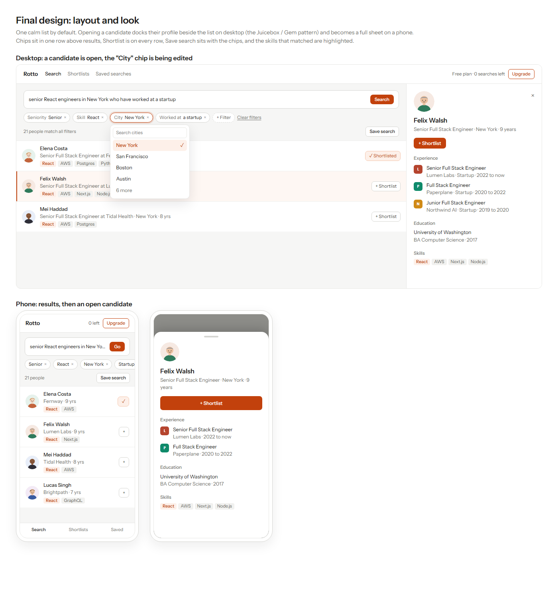
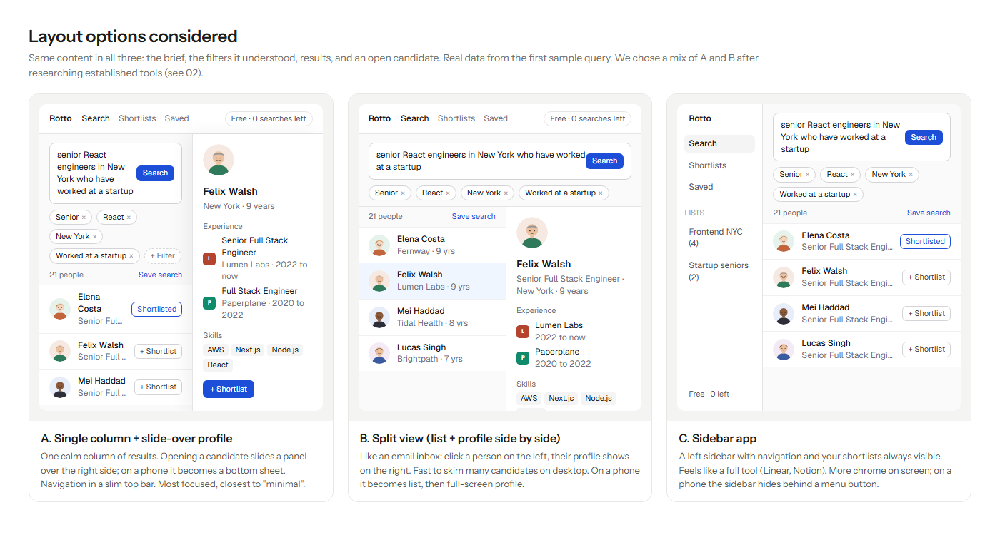
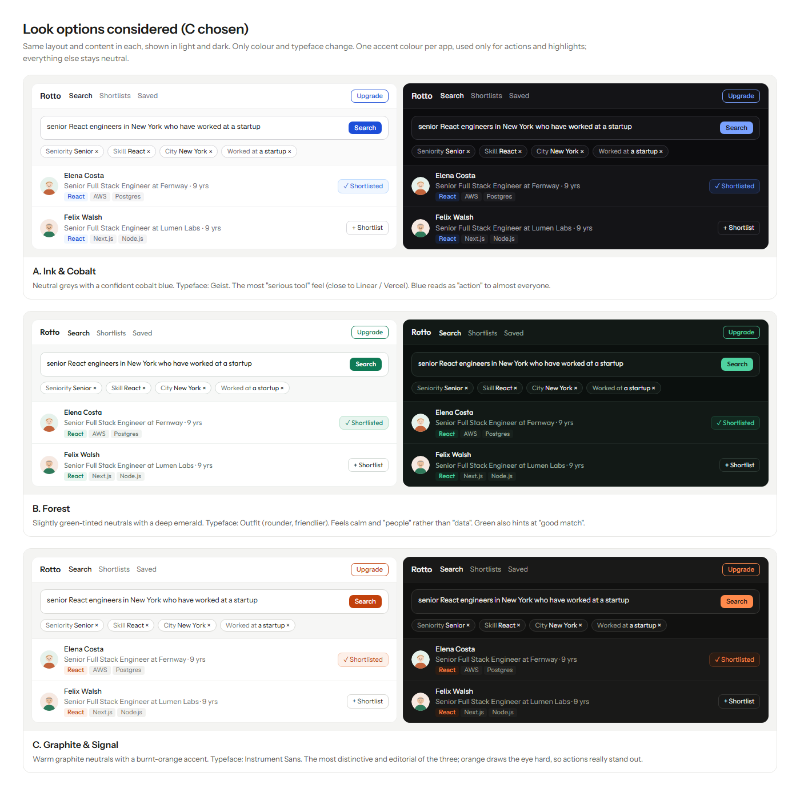
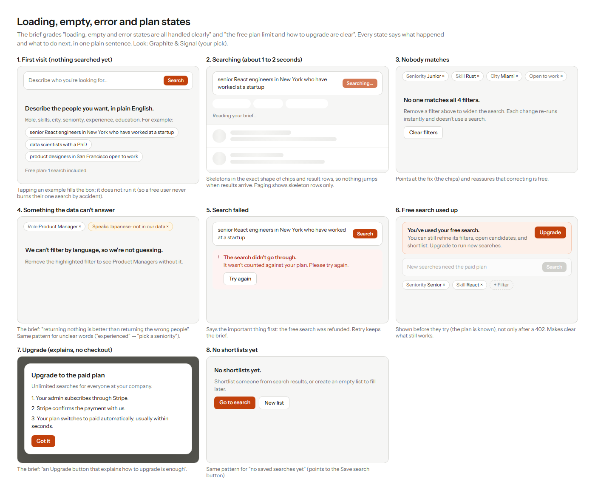

# Design Decisions

This document records how the app looks and behaves, and **why**. Every decision traces back to a line in the brief or to research into established recruiting tools. Agreed on 2026-10-07; technical decisions live in [NOTES.md](NOTES.md) and the requirements in [SPEC.md](SPEC.md).

## 1. What the brief asks for

> "Design matters as much as the code. We want the app to be **beautiful, intuitive and minimal**: a recruiter should **know what to do without being told**, and **nothing on screen should be there without a reason**."

Product and UI are worth **20 points**, as five checks of 4 points each, done by the graders **on desktop and on a phone**:

| # | Graded check (verbatim) | Where it lives in our design |
|---|---|---|
| 1 | "a recruiter can see the filters the app understood and correct them easily" | **The chip row** above the results: tap a chip to edit it, × to remove it, **+ Filter**, **Clear filters** (§4.2) |
| 2 | "loading, empty and error states are all handled clearly" | **Eight designed states** (§6) |
| 3 | "search, results and shortlists work well on a phone" | **Phone layout:** chips scroll sideways in one row, the profile is a full sheet, navigation at the bottom (§4.6) |
| 4 | "the free plan limit and how to upgrade are clear" | **Plan + Upgrade** always in the top bar, a "free search used" banner, and an Upgrade dialog (§6, states 6 and 7) |
| 5 | "it is obvious how to shortlist a candidate and save a search" | **A Shortlist button on every result** and in the profile; **Save search** next to the result count (§4.3, §4.4) |

## 2. Research: what established tools do

Before designing, we looked at products built around the same idea (describe who you want in plain English, see the filters, get ranked people) and at published filter-UI guidance.

| Product | Understood filters | Results | Candidate detail | Shortlisting |
|---|---|---|---|---|
| **Juicebox (PeopleGPT)**, the closest match | Shown for review and adjustment | Ranked list | A **side-by-side** "Review" view | "Shortlist as you scroll", from the profile, or in bulk |
| **Gem AI Sourcing** | Editable generated filters | Ranked list on the left | Profile **beside the list** | Yes / No / Maybe, bulk add |
| **LinkedIn Recruiter** | A filter panel | List | A new tab (the older pattern) | **"Save to pipeline" on every row**; a named **Save search** |
| **Apollo** | A natural-language query turned into filters | Table | — | — |
| **Stripe** (guidance) | **Chips above the list**: value + × to clear, **+** to add, **Clear filters** shown only when filters are active | — | — | — |
| **SAP Fiori** (guidance) | A "filter feedback bar": **one horizontally scrolling chip row** above the list; tap to edit | — | — | — |

**What we took from it:** chips above the results; a shortlist action on every row; the profile beside the list rather than on a new page; save search next to the results; "why this person" made visible (in our case, the matched skills are highlighted, since every result matches every filter exactly).

Sources: [Juicebox search docs](https://docs.juicebox.ai/search) · [Juicebox PeopleGPT](https://juicebox.ai/peoplegpt) · [Gem AI sourcing](https://help.gem.com/external/getting-started-with-ai-sourcing) · [LinkedIn Recruiter guide](https://www.leonar.app/blog/how-to-use-linkedin-recruiter) · [Apollo filters](https://knowledge.apollo.io/hc/en-us/articles/4412658716941-Use-Person-Info-Filters-to-Search) · [Stripe filter controls](https://docs.stripe.com/stripe-apps/patterns/filter-controls) · [SAP Fiori filter feedback bar](https://experience.sap.com/fiori-design-android/v0-9/filter-feedback-bar/)

## 3. Final design

## 4. Layout and interaction decisions

### 4.1 Overall layout: one list, with the profile docked beside it
- **Default:** a single calm column (brief → chips → result count → results). Nothing else competes for attention.
- **Opening a candidate:** on desktop the profile **docks beside the list**, so the recruiter can keep clicking through people without closing anything (Juicebox / Gem). On a phone it's a **full-height sheet**.
- **Rejected:** a permanent split view (more clutter when nobody is open) and a sidebar app (always-visible chrome; not what the AI sourcing tools do; conflicts with "nothing on screen without a reason").

### 4.2 The filter chips (graded check 1)
- **One row of chips directly under the brief**, each labelled with its kind and value: *Seniority Senior*, *Skill React*, *City New York*, *Worked at a startup*.
- **Tap a chip → a small searchable menu of the allowed values only** (e.g. our 10 cities). The recruiter can never type a value our data doesn't have.
- **× removes** a chip; **+ Filter** adds one; **Clear filters** appears only when at least one filter is active (Stripe).
- **Every change re-runs the search instantly, without the AI, and doesn't use a search** (a free correction; SPEC FR-4).
- **Unsupported or unclear words** appear as **amber chips** with a reason ("Speaks Japanese · not in our data"). Results stay empty until the chip is removed or fixed.

### 4.3 A result row (graded check 5)
- Photo, name, *title at company*, city, years of experience, and up to four skills with **the ones that matched highlighted** in the accent colour.
- **A Shortlist button on every row.** It turns into **✓ Shortlisted** once added. Clicking opens a small menu to choose the list, or create one.
- The selected (open) row is tinted, with an accent edge.

### 4.4 Save search (graded check 5)
- A **Save search** button **next to the result count**, i.e. next to what it saves. It saves the brief plus the current (possibly corrected) filters.

### 4.5 Candidate profile (brief: "experience, education and skills")
- Photo, name, title, city, years; a **Shortlist** button at the top; **Experience** (company logo, title, company, startup/enterprise, years); **Education** (school, degree, field, year); **Skills** (matched ones highlighted).
- If a section has no data, it says so; it doesn't disappear.

### 4.6 Phone (graded check 3)
- The chips stay **one row and scroll sideways** (SAP); they never wrap into a tall block that pushes results down.
- Navigation (**Search · Shortlists · Saved**) moves to a **bottom bar** within thumb reach.
- Result rows use a compact shortlist button (**+** / **✓**), at least 44 px to tap.
- The profile opens as a **full-height sheet** with a full-width **Shortlist** button.

### 4.7 Plan and upgrade (graded check 4)
- The top bar always shows the plan: *Free plan · 1 search left* / *0 searches left* + **Upgrade**, or *Paid plan*.

## 5. Look: "Graphite & Signal"

Warm graphite neutrals, **one purple accent** used **only** for actions and highlights, and the typeface **Montserrat**. **Light and dark**, following the device setting.

> **Changed 2026-10-08 (user):** the accent and font now match rotto.com: purple instead of burnt orange, Montserrat instead of Instrument Sans, plus a soft glow drifting behind the search box (still for reduced-motion users). The purple is a little deeper than rotto.com's `#6c5ce7`, which measures 4.49:1 as small text, just under the 4.5:1 minimum; `#5b4bdb` measures 5.2–6.0:1 in light mode and 6.9–8.2:1 in dark. The original orange screenshots in `docs/design/` show the earlier accent; layout and states are unchanged.
>
> **Also 2026-10-08 (user): the search page is a landing page before the first search,** like rotto.com: a large centred headline ("Find the right people, in plain English."), one line of explanation, a large centred search box with the glow, and the examples centred below. After a search it becomes the working layout (search bar on top, chips, results); state 1 (first visit) keeps its rule that examples fill the box but never run it.

| Token | Light | Dark | Used for |
|---|---|---|---|
| Background | `#f6f6f5` | `#111110` | Page |
| Surface | `#ffffff` | `#191918` | Cards, rows, inputs |
| Text | `#1c1c1a` | `#f2f2f0` | Primary text |
| Muted text | `#6f6f6a` | `#a3a39d` | Secondary text, labels |
| Line | `#efefed` | `#252524` | Row dividers |
| Border | `#d6d6d2` | `#363634` | Inputs, chips, buttons |
| **Accent** | `#5b4bdb` (was `#c2410c`) | `#a99ffd` (was `#ff8a4c`) | Primary buttons, highlights, selected states |
| Accent background | `#fdf0e9` | `#2c1c13` | Matched skills, "Shortlisted" |
| Warning (unsupported chip) | `#92400e` on `#fef6e7` | dark variant | "Not in our data" chips |
| Error | `#b42318` on `#fef3f2` | dark variant | Failed search |

**Shape rule:** chips are fully rounded (pill); buttons and inputs 7 to 10 px; panels and cards 12 px. Used the same way everywhere.

## 6. States (graded checks 2 and 4)

| # | State | What it says and does | Why |
|---|---|---|---|
| 1 | First visit | A one-line prompt plus three example briefs; tapping one **fills the box, doesn't run it** | "Know what to do without being told"; a free user can't burn their one search by accident |
| 2 | Searching | "Reading your brief…" plus skeletons shaped exactly like chips and rows | Nothing jumps when results arrive; paging shows skeleton rows only |
| 3 | Nobody matches | "No one matches all 4 filters." Points at the chips; corrections are instant and free | Shows the fix |
| 4 | Data can't answer | An amber chip with a reason; "we're not guessing" | Brief: "returning nothing is better than returning the wrong people" |
| 5 | Search failed | **"It wasn't counted against your plan"** first, then **Try again** (keeps the brief) | The worry first, then the fix |
| 6 | Free search used up | A banner **before** they try: what still works (refine, open, shortlist) + **Upgrade**; the search box explains it's disabled | The limit is clear before it bites, not only after a 402 |
| 7 | Upgrade | A dialog with three plain steps (subscribe through Stripe → Stripe confirms → plan switches automatically); no checkout | Brief: "an Upgrade button that explains how to upgrade is enough" |
| 8 | No shortlists / no saved searches | "No shortlists yet." + **Go to search** / **New list** | Every empty screen has a next step |

## 7. Quality rules (apply to every screen)

- **One accent colour**, only for actions and highlights. No gradients, glows or purple.
- **Contrast:** text and buttons meet WCAG AA in light and dark. Every button label fits on one line.
- **Keyboard and screen readers:** every control is reachable by keyboard with a visible focus ring; inputs have labels (never placeholder-only); dialogs trap focus and close on Esc.
- **Motion:** small and purposeful only (the panel sliding in, chip changes, skeleton shimmer), and switched off under "reduce motion".
- **Copy:** plain, short, functional sentences; no em-dashes; one name per action (always "Shortlist", always "Save search", always "Upgrade").
- **Confirmations happen in the app**, never in browser `confirm()` pop-ups (e.g. "Delete 'Frontend NYC'?").
- **Icons** come from one library (Phosphor); none are hand-drawn.
- **Candidate photos and company logos load directly in the browser with a plain ``, never through the server.** The image host blocks automated (server-side) requests with a bot challenge, so routing images through Next.js's image optimiser would break every photo. Found while rendering these screenshots.

## 8. How these images were made

The screens are HTML mockups using real candidates from `data/candidates.json`. Their sources are in [`design/src/`](design/src/); each PNG was rendered with headless Chrome at 1400 px wide (a normal browser user-agent is needed, or the image host blocks the photos). They're design references, not app code.
